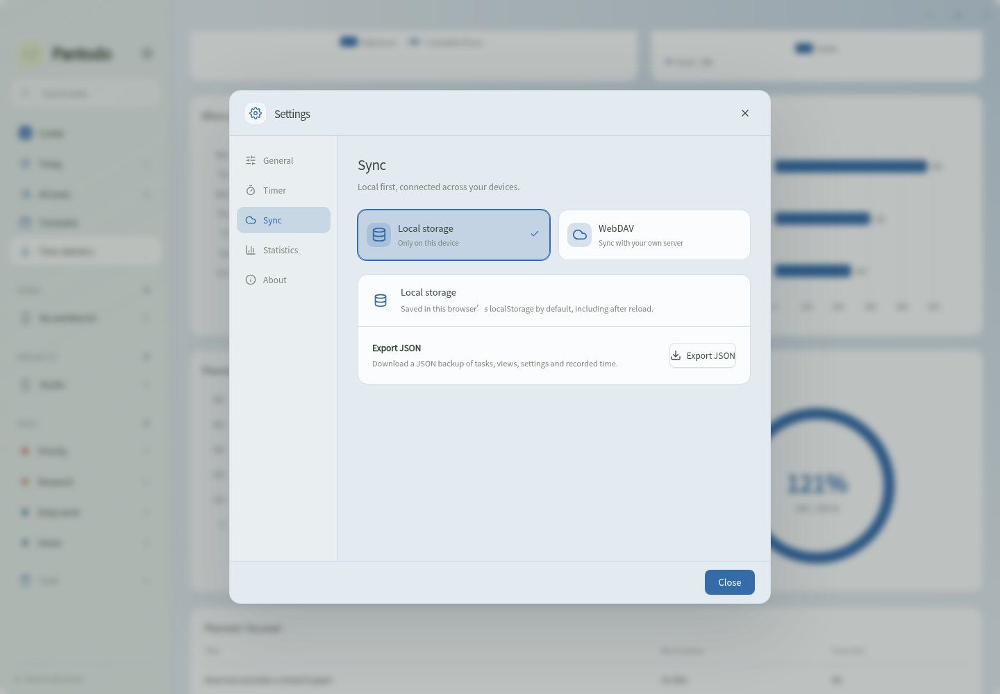
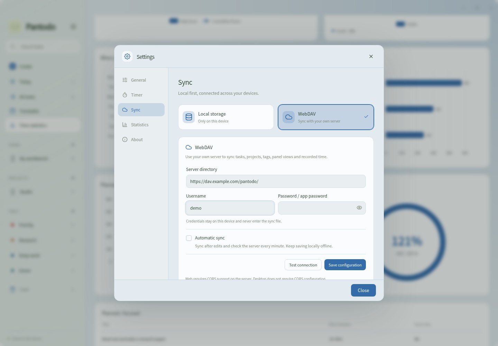
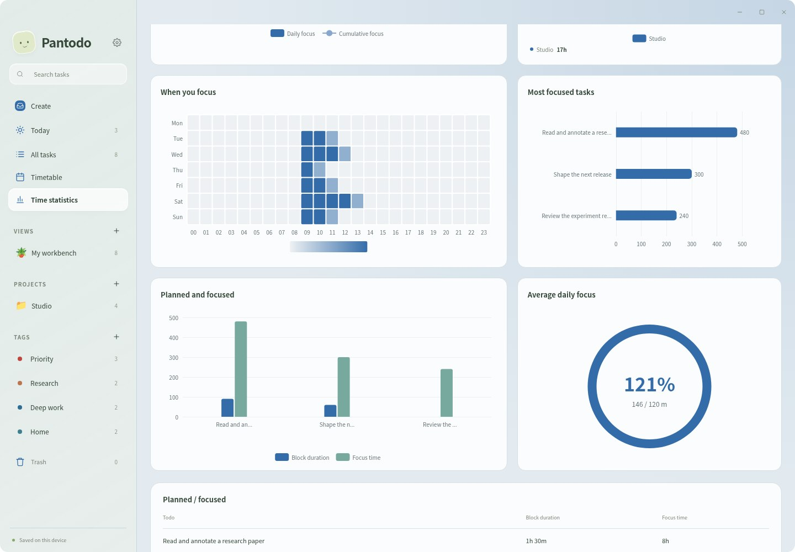
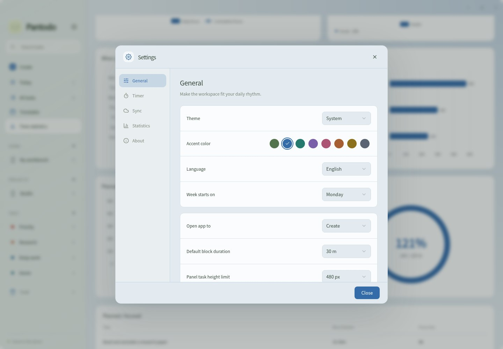
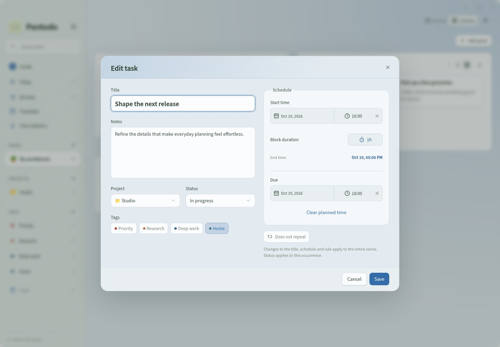
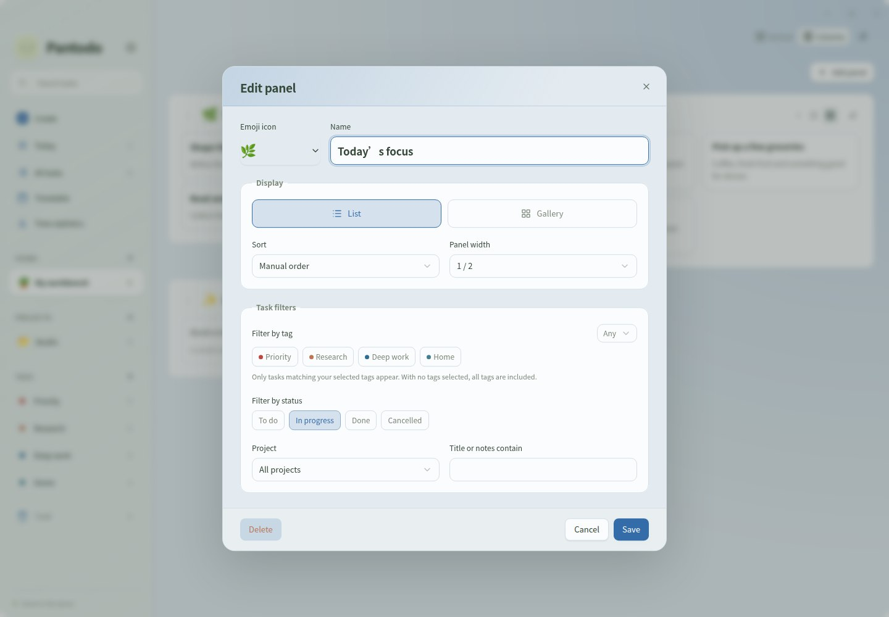
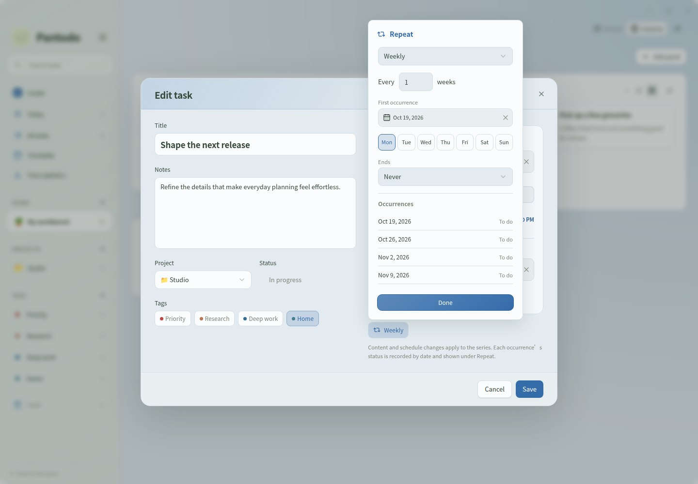
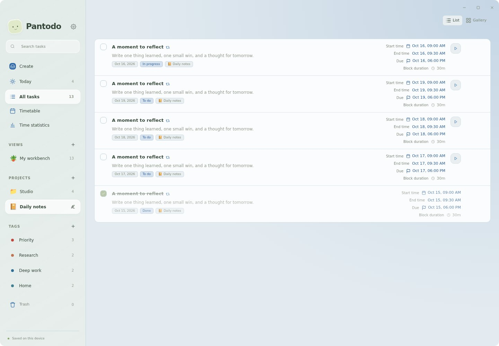

<p align="center"></p>
<h1 align="center">Pantodo</h1>
<p align="center"><strong>A little room for your tasks and your time.</strong></p>
<p align="center">Capture an idea. Give it time. Make a little progress.<br>A calm desktop workspace for the things you want to do.</p>
<p align="center"><a href="https://github.com/kevinhuang001/pantodo/releases">Download Pantodo</a> · <a href="#get-started">Get started</a> · <a href="README.zh-CN.md">简体中文</a> · <a href="README.ja.md">日本語</a></p>
<p align="center"><a href="https://github.com/kevinhuang001/pantodo/actions/workflows/ci.yml"></a></p>


## A quieter way to get things done

A task list for everything on your mind. A timetable for the time you want to set aside. A timer for the work that actually happens. Pantodo brings them together in one softly frosted space, without requiring an account.

- **Capture without friction.** Write a task, add a description, and choose a project or tags when you need them.
- **Plan with less effort.** Pick a start and duration; the end is calculated for you. Set a separate deadline, with or without a plan.
- **See what matters.** Build your own views from filtered panels. Use lists or galleries, arranged vertically or in columns.
- **Stay with one thing.** Start a work session, pause for a break, and return to a focused workspace.
- **Keep your workspace yours.** Save locally and optionally sync through your own WebDAV server.
- **Feel at home.** macOS, Windows and Linux; English, 简体中文 and 日本語; light and dark themes with eight accent colors.

## From a thought to a plan

### A place to start

One writing surface, a little paper companion, and room for the details. Scheduling, deadlines, projects and tags stay within reach, opening only when you need them.


### Give your task some time

Choose the start date and time, then a block duration. Use a preset or choose Custom to enter hours and minutes. Pantodo calculates the end, including plans that cross midnight. Deadlines remain independent and appear as accent-colored flag labels in the timetable. Switch between day, week and month views; pinch or use the slider to adjust the time scale.


### Your views, your way

Create a view, add panels, and choose which tasks belong in each one. Filter by project, included tags, status or text. Panels show just the task name and description; click a task to open its full details. Long collections scroll inside the panel, so the whole workspace stays manageable.

Use List or Gallery within each panel. Arrange panels vertically or in columns, then drag their handles to reorder them. Column counts live in View settings.


### Make time visible

Start a task’s timer from Today or All tasks. Focus opens after a short countdown, while the sidebar stays available. Pause, resume or save the session whenever you need. Recorded Focus time is distinct from the planned Block duration. Statistics brings daily totals, project and tag breakdowns, manual time entries and CSV export together.


### Make it feel like yours

Choose a light, dark or system theme, then an accent that suits your space. Set your language and week start in Settings.


_Screenshots show the current application with fictional sample content. Desktop translucency depends on the operating system and compositor._

## Get started

Download an installer from [GitHub Releases](https://github.com/kevinhuang001/pantodo/releases). Open the newest release to find the files for your platform.

| Platform                   | Installer        |
| -------------------------- | ---------------- |
| macOS · Apple Silicon      | `aarch64.dmg`    |
| macOS · Intel              | `x64.dmg`        |
| Windows · x64              | `.exe` or `.msi` |
| Ubuntu / Debian · x64      | `.deb`           |
| Fedora / openSUSE · x64    | `.rpm`           |
| Other Linux desktops · x64 | `.AppImage`      |

1. Open **Create** and write your first task.
2. Add a schedule or a deadline if it needs one.
3. Find it in **Today**, **All tasks**, or **Timetable**.
4. Start a work session from a task, or create your own view to organize the day.

macOS builds are ad-hoc signed. Linux blur and transparency depend on the desktop compositor.

## Local first, sync when you choose

The desktop app saves your workspace on your computer. The browser version uses localStorage by default. Optional WebDAV sync shares tasks, projects, tags, custom views and recorded time through your server. Conflicts stay visible until you choose a version; the active timer and device preferences remain local.

Configure an existing server directory in **Settings → Sync**. Automatic sync is optional. You can also export your workspace from Settings.

## Storage that fits your workflow

Choose **Local** in Settings → Sync to keep everything on this device and export your workspace. Choose **WebDAV** to reveal server configuration and sync controls. Switching back to Local pauses sync and retains your saved connection for later.





## Understand your focus

Interactive ECharts reports combine daily bars and a cumulative trend, project/tag shares, an hourly heatmap, task rankings, planned versus recorded time and goal progress. Hover for details and use chart legends to inspect a series. Statistics code loads only when you open the page.



Settings now include the opening page, default block duration, panel height limit, automatic Focus/countdown, daily goal and default report period.



## For contributors

Built with Tauri, Rust and React. To run the browser application with Node.js 22.12 or later:

```bash
npm ci
npm run dev
```

[User guide](docs/USER-GUIDE.md) · [Development and desktop builds](docs/DEVELOPMENT.md) · [Product specification](docs/SPEC.md) · [Third-party notices](THIRD-PARTY.md) · [Report an issue](https://github.com/kevinhuang001/pantodo/issues)

### Repeat without clutter

Set a custom daily, weekly, monthly or yearly rule, an interval, selected weekdays and an optional end date or count. Pantodo stores one source task and computes calendar occurrences live. Delete a single occurrence or the entire series; completing one cycle keeps future cycles open. Untimed repeats appear in the all-day area.





All past cycles and today appear separately in lists, while the workspace still stores a single Todo. Each dated cycle keeps its own times, status and deletion record. Pantodo catches up missing days on launch; future calendar entries remain previews. Changes to the plan template preserve recorded history.


