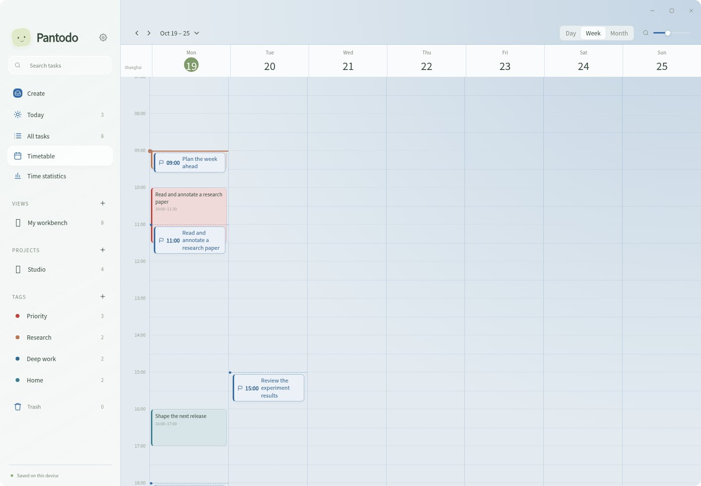
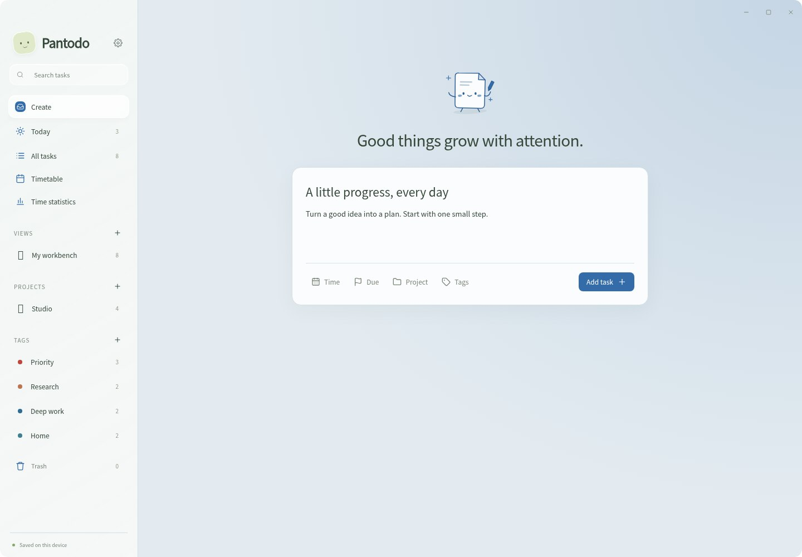
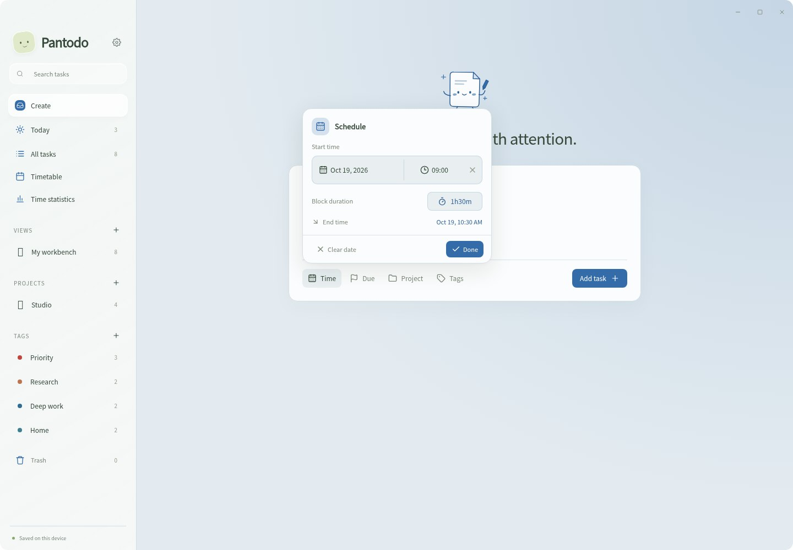
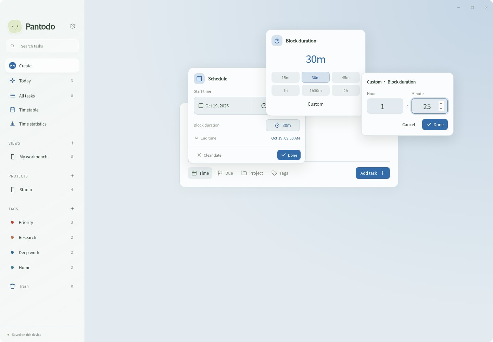
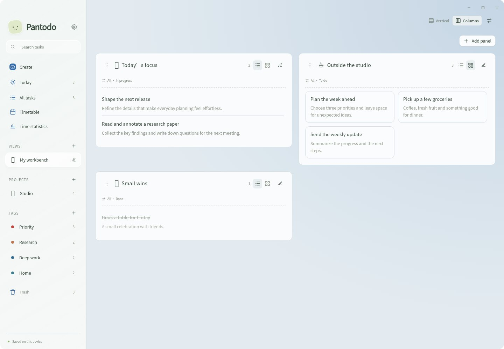
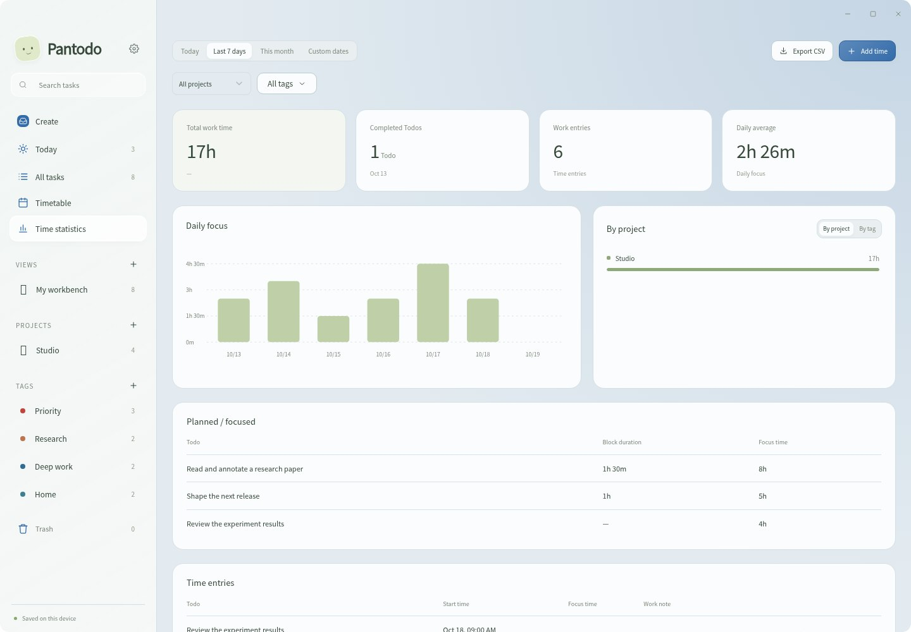
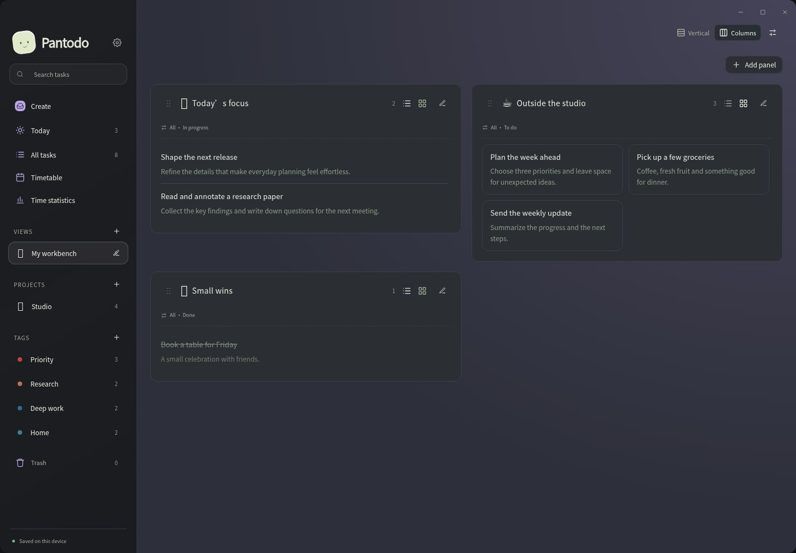

<p align="center"></p>
<h1 align="center">Pantodo</h1>
<p align="center"><strong>让任务与时间，都有一处安放。</strong></p>
<p align="center">记下想法，安排时间，一点点向前。<br>一个安静、轻盈的桌面任务空间。</p>
<p align="center"><a href="https://github.com/kevinhuang001/pantodo/releases">下载 Pantodo</a> · <a href="#开始使用">开始使用</a> · <a href="README.md">English</a> · <a href="README.ja.md">日本語</a></p>
<p align="center"><a href="https://github.com/kevinhuang001/pantodo/actions/workflows/ci.yml"></a></p>



## 给每天的事情，留一点空间

任务列表收纳想法，时间表安排计划，计时器记录实际投入。Pantodo 把它们放进同一个柔和的磨砂界面，无需注册账户。

- **随手记下。** 输入任务名和描述，需要时再选择项目和标签。
- **轻松安排。** 选择开始时间与持续时间，结束时间自动计算；截止时间可独立设置。
- **只看关心的事。** 用独立筛选的面板组合视图，支持列表、画廊、纵向和分栏排列。
- **专注眼前。** 开始工作、暂停休息、继续计时，在专注页面完成一件事。
- **数据由你保管。** 默认保存在本地，也可通过自己的 WebDAV 服务器同步。
- **适合你的环境。** 支持 macOS、Windows、Linux，中英日三种语言、深浅主题和八种主色调。

## 从一个想法开始

### 安静地记录

一张书写卡片，一个小纸人，为描述留出空间。时间、截止日期、项目和标签按需展开，让创建任务保持轻盈。



### 为任务留出时间

选择开始日期、时分和计划时长，结束时间自动计算，跨日计划也一样。快捷时长之外，点击“自定义”可弹出小时／分钟输入框。截止时间保持独立，在时间表上以跟随主色调的旗标展示。按日、周、月查看，使用触控板或滑动杆调整时间尺度。





### 组合自己的工作台

创建视图后添加面板，按项目、标签、状态、日期或文字筛选任务。面板里的任务只显示名字和描述，点击即可打开完整信息。任务多时在面板内部滚动，避免整个工作台被撑得过长。

每个面板可选择列表或画廊；面板之间支持纵向、分栏排列与拖拽排序。分栏数量在视图设置中修改。



### 看见自己的投入

在“今天”或“全部任务”中开始计时，短暂倒计时后进入专注页面，侧栏仍可使用。工作中随时暂停、继续或保存记录。计划时长与实际专注时间分别展示。“时间统计”提供每日总量、项目与标签分布、手动补录和 CSV 导出。



### 选一种舒服的颜色

浅色、深色或跟随系统，配上喜欢的主色调。在设置中选择语言和每周起始日。



_截图来自当前应用，使用虚构示例内容。桌面透光与模糊效果取决于系统和窗口合成器。_

## 开始使用

前往 [GitHub Releases](https://github.com/kevinhuang001/pantodo/releases)，在最新版本中选择对应安装包。

| 平台                    | 安装包           |
| ----------------------- | ---------------- |
| macOS · Apple Silicon   | `aarch64.dmg`    |
| macOS · Intel           | `x64.dmg`        |
| Windows · x64           | `.exe` 或 `.msi` |
| Ubuntu / Debian · x64   | `.deb`           |
| Fedora / openSUSE · x64 | `.rpm`           |
| 其他 Linux 桌面 · x64   | `.AppImage`      |

1. 打开“创建”，写下第一条任务。
2. 按需设置计划时间或独立截止时间。
3. 在“今天”“全部任务”或“时间表”中找到它。
4. 开始一段工作，或创建视图，组合自己的工作台。

macOS 安装包采用临时签名；Linux 透光和模糊效果取决于桌面合成器。

## 本地优先，按需同步

桌面端将工作区保存在电脑上，浏览器端默认使用 localStorage。在“设置 → 同步”中连接已有的 WebDAV 目录，可同步任务、项目、标签、自定义视图和工作记录。冲突需手动选择，运行中的计时器和设备偏好留在本机。自动同步可选，设置中也提供工作区导出。

## 参与开发

使用 Tauri、Rust 和 React 构建。Node.js 22.12 及以上版本可运行浏览器开发环境：

```bash
npm ci
npm run dev
```

[使用说明](docs/USER-GUIDE.md) · [开发与桌面构建](docs/DEVELOPMENT.md) · [产品规范](docs/SPEC.md) · [第三方声明](THIRD-PARTY.md) · [反馈问题](https://github.com/kevinhuang001/pantodo/issues)
